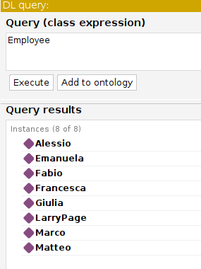
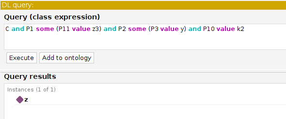

## Testing LLMs reasoning capabilities over OWL DL ontologies
This project was developed as part of the *Knowledge Representation and Semantic Technologies* course with the aim of comparing the reasoning capabilities of LLMs over OWL ontologies against [Protégé](https://protege.stanford.edu), a tool that allows to build owl ontologies and that implements different automated reasoning algorithms.

More precisely, here I test **ChatGPT-5.2** and **Google gemini-3-flash-preview** in the following three tasks:
- Query answering
- Instance checking 
- Consistency checking

and then compare the results with **Protégé**.

We do so considering two different ontologies: 
1. Representing a typical company scenario with **classes** as *Employee*, *Recruiter*, *Job* etc. and **properties** as *wroksIn*, *applies*, *hires* and so on. In other words we have an onotlogy with meaningful classes and properties. This onotlogy is implemented in the `StaffManagement.rdf` file. 
2. Then we consider the "*Character Onotology*" (implemented in the file `Character_ontology.rdf`) where classes and properties have no meaning but are simple letters.

The idea here is to test whether LLMs are **Symbolic Reasoners** or their reasoning is mainly driven by their natural language understanding.

### Implementation

When given in input to the LLMs, the onotologies are rappresented using the *OWL functional syntax*, since it is the most appropriate format for the LLMs. Here we report some of the assertions of the `StaffManagement` ontology:

##### Assertions

```owl
ClassAssertion( :Candidate :Ann)
ClassAssertion( :Candidate :Bob)
ClassAssertion( :Candidate :Luca)

...

ObjectPropertyAssertion( :hasReferent :AIEngineer :Marco)
ObjectPropertyAssertion( :hasReferent :DataEngineer :Marco)
```

#### LLM interaction
To interact with the LLMs the prompt is structured as follows:

```python
prompt = f'
    ### Task Description:
    You are given a knowledge base written in OWL DL functional syntax and a task to
    perform on it, together with some instructions on how to format your output.
    ### The knowledge base:
        {knowledge_base}

    ### The task instructions:
        {task_instructions}

    ### The format of your answer:
        {output_format}

    ### Response:
    '
```

where: 
- **"knowledge_base"**: is the knowledge base expressed in OWL functional syntax.
- **"task_instructions"**: contains the input and the task description. As an example:

```python
instance_checking_task = """
Given the knowledge base that is provided, your task is to tell whether the following assertions hold:
A1: ObjectPropertyAssertion( :worksIn :LarryPage :Google)
A2: ObjectPropertyAssertion( :worksIn :Matteo :Unicredit)
A3: ClassAssertion( :Employee :Giulia)
A4: ObjectPropertyAssertion( :hasReferent :AIEngineer :Matteo)

showing for each of them in detail the reasoning steps that led to the answers (which must be YES or NO).
"""
```

- **"output_format"**: contains specifications on how the LLM should format the output

### An example of LLMs reasoning

We consider a very simple query, we ask for all the employees.

```
    Q: Employee 
```

#### Gemini

```
"reasoning_steps": "To return all employees, we identify all individuals that are
members of the `Employee` class or its subclasses (`Recruiter`, `Manager`,
`TeamManager`, `CompanyManager`). Francesca and Matteo are explicitly asserted as
`Recruiter`. Marco is inferred to be a `Recruiter` because he is the range of the
`hasReferent` property in `hasReferent(:AIEngineer, :Marco)`. Alessio is inferred to be a
`TeamManager` because he is the domain of the `headOf` property in
`headOf(:Alessio, :CyberSecurityTeam)`. Giulia and LarryPage are inferred to be
`CompanyManager` individuals because they are the domain of the `manages`
property in `manages(:Giulia, :PosteItaliane)` and `manages(:LarryPage, :Google)`.
Emanuela and Fabio are inferred to be `Employee` individuals because they are the
range of the `composedBy` property in `composedBy(:CyberSecurityTeam, :Emanuela)`
and `composedBy(:CyberSecurityTeam, :Fabio)`. All these classes (`Recruiter`,
`TeamManager`, `CompanyManager`) are subclasses of `Employee`.",

"answer": "[Alessio, Emanuela, Fabio, Francesca, Giulia, LarryPage, Marco, Matteo]"
```

#### ChatGPT

```
All individuals explicitly asserted or inferred to be Employees:
Francesca and Matteo are asserted as Recruiters → Recruiter ⊑ Employee.

From Q1, Marco is inferred to be a Recruiter → Employee.

manages(Giulia, PosteItaliane) and manages(LarryPage, Google); domain of
manages is CompanyManager, and CompanyManager ⊑ Manager ⊑ Employee →
Giulia and LarryPage are Employees.

headOf(Alessio, CyberSecurityTeam); domain of headOf is TeamManager, and
TeamManager ⊑ Manager ⊑ Employee → Alessio is an Employee.

composedBy(CyberSecurityTeam, Emanuela) and
composedBy(CyberSecurityTeam, Fabio); range of composedBy is Employee →
Emanuela and Fabio are Employees.

--- [Francesca, Matteo, Marco, Giulia, LarryPage, Alessio, Emanuela, Fabio]
```

In both cases the answer was correct as showed also by the result obtained from **Protégé**.

#### Protégé




--------------------------------------------------------

This instead is not always the case when we consider the *Character Ontology*, as showed from this example


Query;
```sql
C and P1 some (P11 value z3) and P2 some (P3 value y) and P10 value k2
```

#### Gemini
```
First, we identify the instances of class C. Based on the knowledge base, C has instances b1 and c1 (from ClassAssertion) and z (since z is the domain of a P2 assertion and ObjectPropertyDomain(:P2 :C)). For each of these candidates, we check the other conditions. 1. For z: (a) P1 some (P11 value z3): z has a P1 property to w (ObjectPropertyAssertion(:P1 :z :w)), and w has a P11 property to z3 (ObjectPropertyAssertion(:P11 :w :z3)). This condition is satisfied. (b) P2 some (P3 value y): z has a P2 property to e2 (ObjectPropertyAssertion(:P2 :z :e2)), and e2 has a P3 property to y (ObjectPropertyAssertion(:P3 :e2 :y)). This condition is satisfied. (c) P10 value k2: z has a P10 property to k2 (ObjectPropertyAssertion(:P10 :z :k2)). This condition is satisfied. 2. For b1: (a) P1 some (P11 value z3): There are no P1 assertions for b1. This condition is not satisfied. 3. For c1: (a) There are no P1 or P2 assertions for c1. This condition is not satisfied. 
--- [z]

```

#### ChatGPT

```
We look for individuals satisfying:
C and P1 some (P11 value z3) and P2 some (P3 value y) and P10 value k2.
Instances of C are: b1 and c1.
Since C ⊑ B and B ⊑ A, both b1 and c1 are also instances of A.
Check the P1 condition:
P1 has domain A and range F.
b1 has no P1 assertion.
c1 has no P1 assertion.
Thus neither b1 nor c1 satisfies “P1 some (P11 value z3)”.
Even before checking the remaining conditions (P2 some (P3 value y) and P10 value k2), we
already see that no instance of C satisfies the P1 condition.
Therefore:
Q1: No individual satisfies all the given conditions --- []
```

#### Protégé



As we can see, here *ChatGPT* gives the wrong answer.